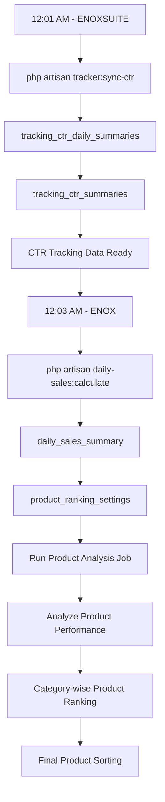

# CTR Tracking – ENOXSUITE Deployment Guide

## STEP OVERVIEW: Complete CTR Tracking & Product Ranking Workflow

The following workflow explains how CTR tracking data moves from ENOXSUITE to ENOX and is ultimately used for category-wise product ranking.

## Full Module Workflow Diagram



## STEP 1: Deploy ENOXSUITE

Deploy the latest ENOXSUITE application code to the production server.

Server path:

```bash
/srv/enox_erp
```

Ensure the deployment is completed successfully before proceeding with the database migrations.

## STEP 2: Run Database Migrations

Execute the following commands to create the CTR tracking summary tables in the `tracking` database.

**2.1. Create Tracking CTR Summaries Table**

```bash
php artisan migrate:refresh --database=tracking --path=database/migrations/tracking/2026_10_18_100016_create_tracking_ctr_summaries_table.php
```

**2.2. Create Tracking CTR Daily Summaries Table**

```bash
php artisan migrate:refresh --database=tracking --path=database/migrations/tracking/2026_10_18_100017_create_tracking_ctr_daily_summaries_table.php
```

**2.3. Run Remaining Tracking Migrations**

```bash
php artisan migrate --database=tracking --path=database/migrations/tracking
```

**Important:** `migrate:refresh` rolls back and reruns the specified migration. If these tables already contain production data, verify the impact before executing these commands. Use `migrate` instead if the migrations have already been executed and existing data must be preserved.

## STEP 3: Configure CTR Tracking Cron Job

Add the following cron job to the ENOXSUITE production server.

```bash
1 0 * * * cd /srv/enox_erp && php artisan tracker:sync-ctr >> /srv/enox_erp/storage/logs/schedule.log 2>&1
```

**Execution Schedule:** Daily at 12:01 AM (server timezone).

**Purpose:**

The `tracker:sync-ctr` command processes CTR tracking data and generates/updates the following tables in the ENOXSUITE tracking database:

1. `tracking_ctr_daily_summaries`
2. `tracking_ctr_summaries`

**Log Location:**

```bash
/srv/enox_erp/storage/logs/schedule.log
```

Verify that the cron job executes successfully and both tracking tables receive the expected data.

---


## Workflow Execution Details

### 1. ENOXSUITE – CTR Tracking (12:01 AM)

**Command:**

```bash
php artisan tracker:sync-ctr
```

**Responsibilities:**

- Synchronizes product CTR tracking data.
- Generates/updates `tracking_ctr_daily_summaries`.
- Generates/updates `tracking_ctr_summaries`.
- Makes the latest CTR data available for product analysis.

### 2. ENOX – Daily Sales Calculation (12:03 AM)

**Command:**

```bash
php artisan daily-sales:calculate
```

**Responsibilities:**

- Calculates the previous day's product sales.
- Generates/updates the `daily_sales_summary` table.
- Updates `product_ranking_settings` using daily sales data.
- Prepares sales information for product performance analysis.

### 3. Product Analysis Job

After CTR synchronization and daily sales calculation are completed, execute the product analysis job.

**Responsibilities:**

- Reads CTR tracking data from ENOXSUITE.
- Reads sales information from ENOX.
- Analyzes product performance.
- Calculates the required ranking metrics.
- Prepares product ranking information category-wise.

### 4. Final Category-wise Product Ranking

Once product analysis is completed:

- Products are ranked independently within their respective categories.
- CTR and sales performance data are used for product evaluation.
- Product ranking results are prepared for category-wise sorting.
- The final product sorting is applied to the ENORSIA storefront.

---

## STEP 5: Post-Deployment Verification Checklist

- [ ] ENOXSUITE deployed successfully.
- [ ] `tracking_ctr_summaries` migration completed.
- [ ] `tracking_ctr_daily_summaries` migration completed.
- [ ] Remaining tracking migrations completed.
- [ ] CTR tracking cron job configured at 12:01 AM.
- [ ] `schedule.log` verified for successful execution.
- [ ] `tracking_ctr_daily_summaries` populated.
- [ ] `tracking_ctr_summaries` populated.
- [ ] ENOX daily sales cron job configured at 12:03 AM.
- [ ] `daily_sales_summary` populated.
- [ ] `product_ranking_settings` updated.
- [ ] Product analysis job executed successfully.
- [ ] Category-wise product ranking generated.
- [ ] Final product sorting verified on ENORSIA.

---

**Module:** CTR Tracking & Smart Product Ranking

**Applications:** ENOXSUITE → ENOX → ENORSIA

**Environment:** Production
